# Slogan

> 把一道高中物理题，变成一张形象、能拨动的物理模型。
>
> 新会话续作请先读 [SESSION-HANDOFF.md](SESSION-HANDOFF.md)。

面向高中物理的**题目 → 建模工具**：一道题进去，一张可运行、可修改的模型出来，存进自己的收藏夹。
Web 与微信小程序两个壳都已跑通，核心三层完全平台无关。

## 产品定位

「Slogan」不是课程，也不是实验复现。它只做一件事：**把题目变成一张形象、易懂、可拨动的物理建模**。

- **底部三栏**：用户 / 题库 / 模型；进到画布后是**左参数面板 + 右舞台 + 底部 v–t 图**。
  题库（首页，按物理知识分类）→ 点一张题先看完整题干 → 再决定「生成建模」→ 模型进「模型」页（收藏夹）。
- **输出是模型，不是答案**：播放后看到轨迹、速度/受力箭头、v–t、能量与动量判据；改一个条件再跑，看结果怎么变。
  不判对错、不替代老师讲题、不追求逼真。
- **生成不保证对，所以必须可改**：生成的是初稿。拖拽、检查器、世界面板、手绘、组件都能继续改；
  建不了就**在原地说清楚缺什么**，不悄悄给一个错模型。
- **零后端**：建模库、文件夹、自己导入的题目都存在本地（Web: localStorage / 小程序: `wx.setStorageSync`），不登录、不上传。

### 一条原则，三个不做

> **产品只提供「物理情境」，不提供「怎么讲」。**
> 判据：新增功能若在表达「先这样、再那样」→ 不做；若在扩展「这个情境能被怎么摆弄」→ 做。

**不做课件**（位置被希沃 + NB 占住）· **不做「讲法」**（不替老师决定怎么讲）· **不做白板**（批注只做「指出某处」）。

核心指标不是留存，是 **T = 从「我手上有这道题」到「模型在屏幕上能拨」的秒数**：课堂 ≤ 10 秒、备课 ≤ 60 秒。
理由与数据见 [docs/RESEARCH.md](docs/RESEARCH.md) 与 [docs/DECISIONS.md](docs/DECISIONS.md) §3。

```
┌────────────────────┬─────────────────────────────────────────┐
│ SLOGAN             │  ▶  ● 已暂停          题目初稿 · 可改  ⬤ ↗ │
│ 斜面滑块           │                                         │
│ 球 A · 可动        │                                         │
│                    │              2D 平面画布（Canvas 2D）     │
│ ▸ ▱ ⇉ ⌗           │      物体 · 轨迹 · 速度/受力箭头 · 场区域 │
│ ↪ ✎ ⌫ ✋          │                                         │
│                    │                                         │
│ 质量 m      0.20kg │                                         │
│ ──────●────────    │                                         │
│ 摩擦 μ      0.25   │                                         │
│ ──●────────────    │                                         │
│ 假设 光滑/粗糙      │                                         │
│                    │                                         │
│ [   重新开始   ]   ├─────────────────────────────────────────┤
│ [   重置视图   ]   │ m/s                                     │
│ 主体: 滑块         │            ╱‾‾‾‾‾                      │
│                    │        ╱‾‾‾                             │
│ 当前速度   0.00 m/s│   ╱‾‾‾‾                                │
│ 已运行     0.00 s  │                                         │
│ 世界 组件 题目 返回 │                               t (s)   │
└────────────────────┴─────────────────────────────────────────┘
```

窄屏（手机 / 小程序，宽度 < 760）左面板变成底部抽屉，图表收起——舞台占满，其余照旧。

## 快速开始

```bash
npm install
npm run dev          # Web：http://127.0.0.1:5173
npm test             # 145 个单测，7 秒
npm run typecheck
npm run doc:check    # 文档行数与代码一致
npm run validate     # 三项技术验证（摩擦覆写 / 洛伦兹漂移 / Canvas 性能）
npm run build        # Web 产物：约 483 KB / gzip 135 KB
npm run build:mp     # 小程序包：约 474 KB → apps/miniprogram/miniprogram/utils/app.js
```

需要 Node ≥ 20。实测环境：Node 24 / Chrome / Windows。

### 小程序

1. `npm run build:mp`
2. 微信开发者工具 → 导入项目 → 目录选 `apps/miniprogram` → AppID 用你自己的
   （`project.config.json` 里现在是测试 AppID）→ 不使用云服务。
3. 想跑自动化验证（开发者工具：设置 → 安全设置 → 打开服务端口）：
   ```bash
   cli.bat open --project D:\Slogan\apps\miniprogram
   cli.bat auto --project D:\Slogan\apps\miniprogram --auto-port 9420
   node scripts/mp-verify.mjs    # 15 项
   ```

小程序壳只有 160 行左右（[pages/index/index.js](apps/miniprogram/miniprogram/pages/index/index.js)）：
取 canvas、喂尺寸与安全区、转发触摸、驱动帧循环、题目输入弹窗。其余全部来自打包后的 `core + physics + render + ui`。

## 题库（首页）

首页不是示例卡片，是**一道一道题**，按物理知识模块分类：

- **分类**：力学 / 电磁学 / 热学（有导入题时多一个「我的题目」）。口径沿用 304 卷真题统计的「知识模块」轴。
- **每条题带状态**：`可建模` / `已建` / `暂不支持`——**人工标注**（规则解析删掉后不再自动验证，
  AI 的能力在变，静态标注本来就会过时）。`tests/bank.test.ts` 只保证标注本身合法。
- **来源分三类**：真题（标卷号，可核）／示例题（自编，明确标「示例题（自编，非真题）」）／我的题目（自己导入的）。
- **点一下先看题**：进入题目详情页，完整题干、来源、标签、状态都在；底部才是「生成建模 →」。
  建过的题这里变成「打开模型 →」，同一道题不会重复建。

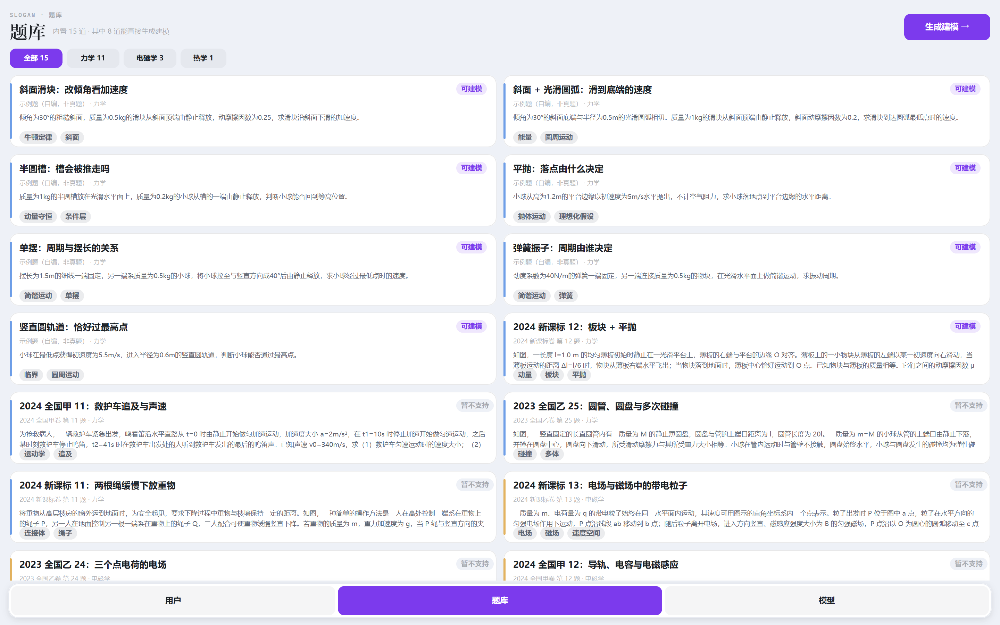

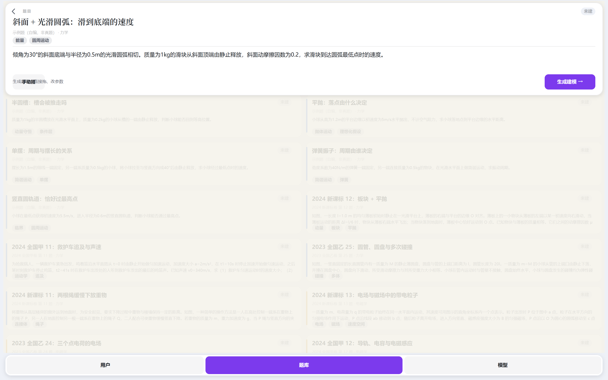

## 生成建模

**只有一条路：由模型读题、决定怎么建。** 建不了就落到编辑器手动搭——**没有第二套生成器**。

- **两个入口**：题库里点一张题 → 详情页按「生成建模」；或者右上角「生成建模」直接贴题干。
- **入口要先配 key**：用户页 →「AI 建模」→ 粘贴 API key（只存在这台设备上，不上传、不进仓库）。
  没配 key 时点生成会**明确告诉你缺什么**，不会静默失败。
- **它只能做决定，不能凭空写场景**：要么选一个已有模型（走 `layout()`，几何一定合法），
  要么用基元拼一串阶段（斜面/水平/圆弧/上坡），要么用指令搭（加物体/加约束/加场），
  要么明确说建不了。**没有「大概差不多」这个选项。**
- **失败不假装**：不关弹层，在原地说明缺什么；题目同时记进「我的题目」，改好题干可以直接再生成。
- **建不了就手动搭**：详情页的按钮会变成「手动搭 →」，点开是一张空白画布——画什么就是什么（见下一节）。
- **成功**：模型立刻存进建模库，画布打开就是那一份；舞台左上状态药丸旁边标「题目初稿 · 可改」。

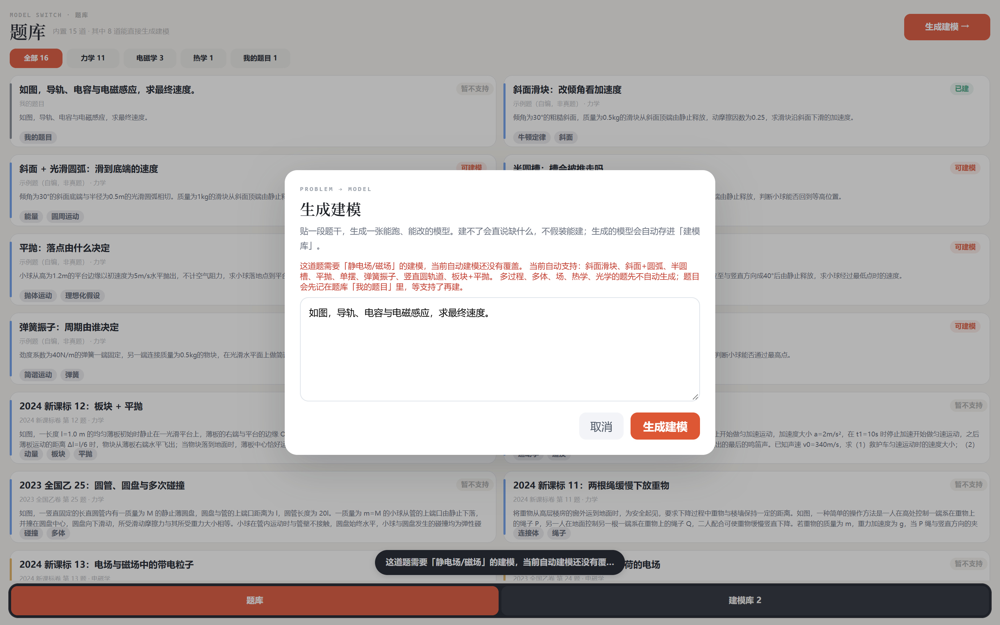

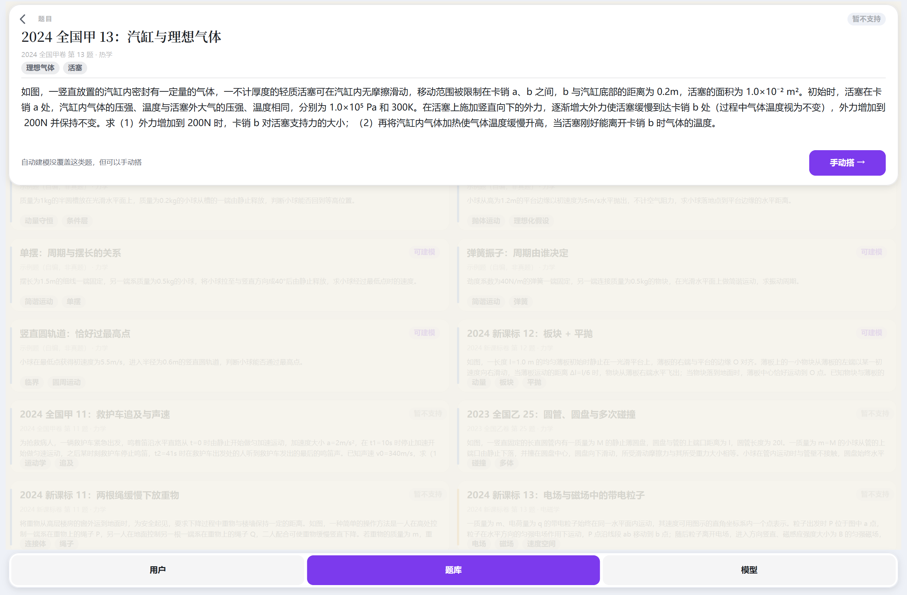

**实测**（glm-4.6）：7 道题 7/7 符合预期——斜面 / 多过程 / 半圆槽 / 圆轨道走预置或拼阶段，
传送带和电机用搭建指令现搭，电磁感应明确拒绝。

> 浏览器直连厂商接口会被跨域预检拦住，所以走一个转发层：开发期 `npm run dev` 已配好，
> 上线需要一个只透传 `Authorization` 的转发（服务端不存 key）。小程序端不支持（无法配置域名白名单）。
> 细节、实测数据与已知局限见 [docs/AI.md](docs/AI.md)。

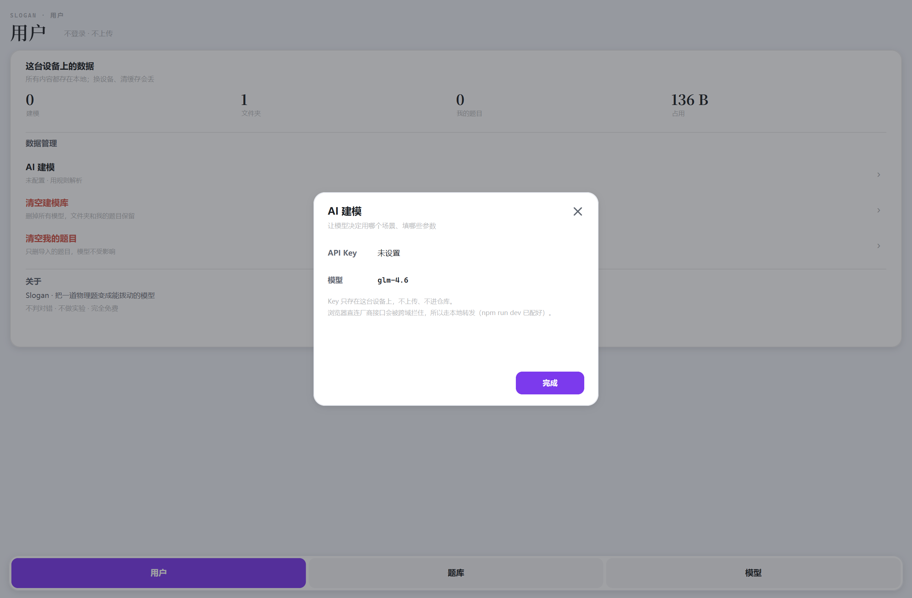

## 建模库（收藏夹）

生成的模型都在这一页，像音乐收藏夹：

- **文件夹**：自己起名（「临界题」「力学第一章」），模型点 `⋯` 移进去。删文件夹时里面的模型回到「未分类」，不会跟着消失。
- **本地持久化**：刷新、重开小程序都还在；零后端、不登录。
- **容量**：上限 60 个模型、20 个文件夹、40 个组件，超了明确提示，不静默丢；页面右上角显示占用。
- **改了就写回**：在画布上拖过、改过参数，返回建模库时写回同一条记录（不新增副本）。

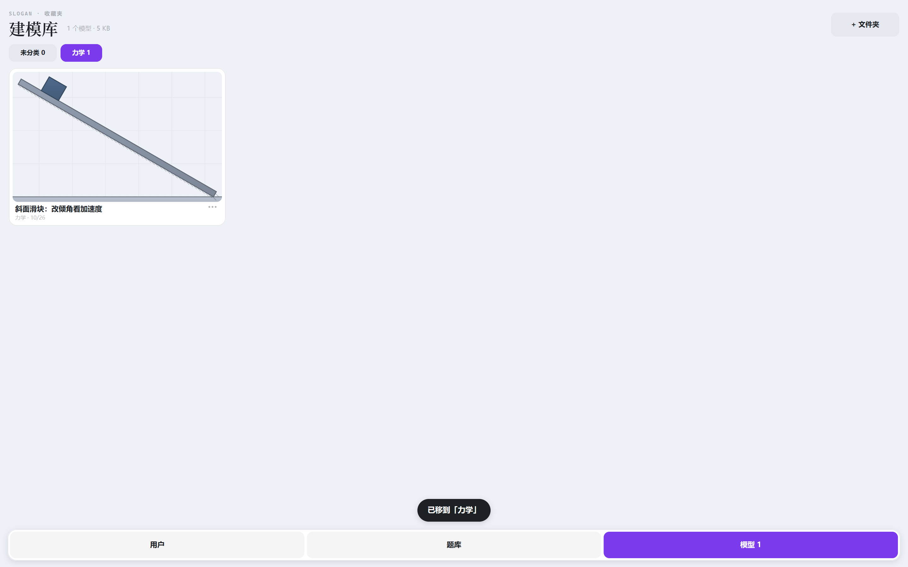

## 用户页

第三栏是「用户」——没有账号体系，只有这台设备上的数据：

- 一眼看到 **建模数 / 文件夹数 / 我的题目数 / 占用空间**；
- 数据管理：清空建模库、清空我的题目（都先弹确认，说明会删几个、什么会保留）；
- 关于：不判对错、不做实验、完全免费。

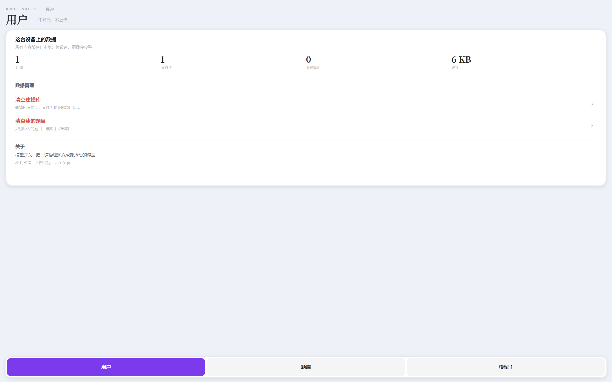

## 编辑器：左参数、右舞台、底部图表

画布页不是一堆工具栏堆出来的，而是一个「参数 → 舞台 → 曲线」的结构（见上面的布局图）：

- **左**：模型标题 + 8 个工具（选择 / 手绘 / 电场 / 磁场 / 连接 / 批注 / 橡皮 / 平移）→ 参数滑杆
  （没选中时是场景参数 θ/μ/v₀/R，选中后换成物体参数）→ 假设 chips → 重新开始 / 重置视图 → 读数卡 →
  世界 / 组件 / 题目 / 返回。滑杆右侧是紫色数值，下面标两端含义（「光滑 (0) / 粗糙 (0.8)」）。
- **右**：播放键 + 状态药丸（题库生成的模型多一个「题目初稿 · 可改」），右上角分享与世界面板；
  舞台本身可画、可拖、可缩。场景按舞台取景，不会被面板压住。
- **下**：v–t / h–t / y–x 图跟着仿真长出来，直接占满舞台底部；没有图表观测器时舞台自动铺满。
  选中物体时检查器浮在舞台底部。
- **配色**：白面板 + 冷灰舞台 + 紫色强调（滑杆、按钮、曲线、选中）。

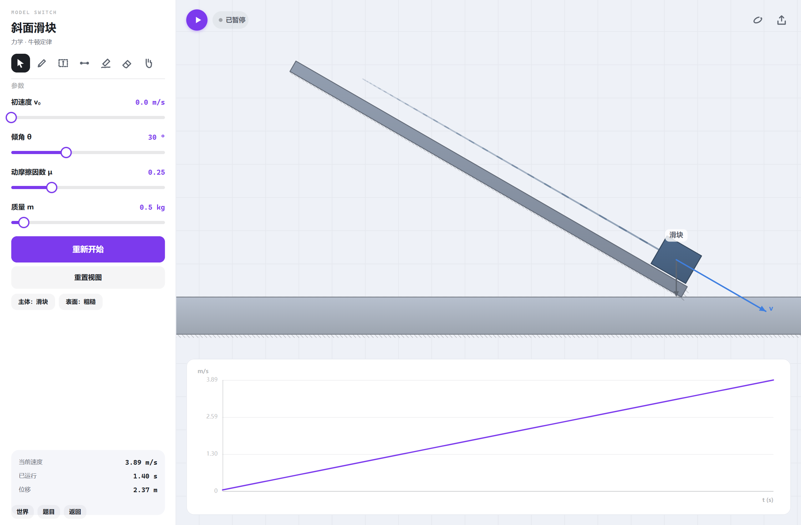

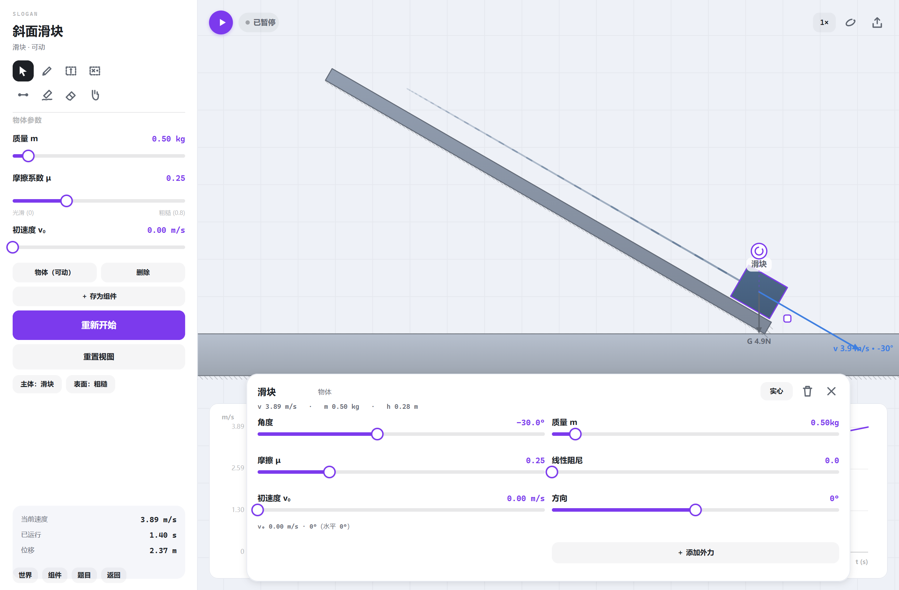

## 在画布上画：画什么，什么就是组件

**没有预置组件库**。左栏只有笔、电场、磁场——不选「矩形/圆/三角」，也不点「点电荷/天体/气缸」。
你画成什么样，系统把它变成什么样：

| 画出来的 | 规整成 | 默认物理性质 |
|---|---|---|
| 一个圈 | 圆（半径取均值） | 球：会动、会滚、会落 |
| 一个方块 | 轴对齐矩形 | 地形：固定、能挡能托，μ 可调 |
| 一个三角 / 多边形 | 多边形 | 地形 |
| 一条线 / 一条曲线 | 直线 / 折线 | 轨道 / 地面 / 挡板 |
| 太小的点 | 不产生东西 | — |

- **场有两个独立按钮**：点「电场」或「磁场」，**按住拖出一个矩形**——场就长在这块区域里（点一下 = 全场）。
  建完自动选中，左侧面板调场强和方向。
- **「光滑」不是一个组件，是一个数**：μ 拖到 0 就是光滑。双击在 地形/物体/轨道 之间循环。
- **大小能直接拖**：包围盒右下角的小方块就是缩放手柄；检查器里还有精确滑杆。
- **场只作用于带电体**：画完场要给球设一个电荷 q，否则什么都不动（toast 会提醒）。

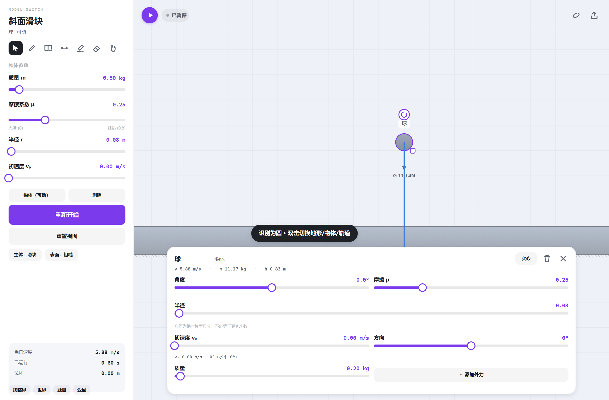

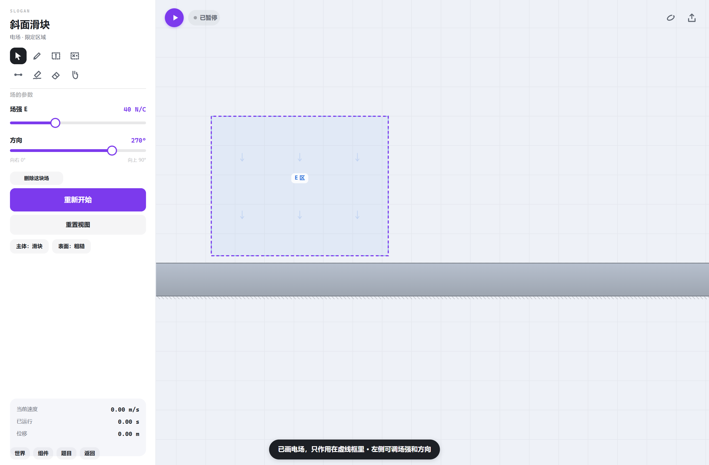

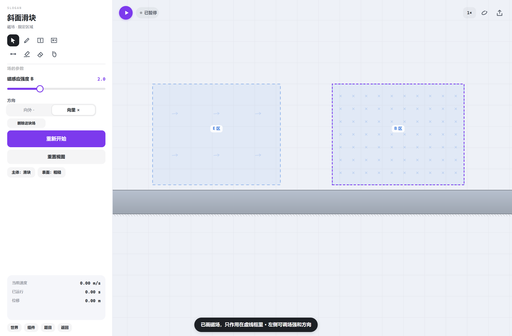

识别阈值、场笔手势、**视觉语法**（固定剖面线 / 磁场 ×· / 带电符号）与**批注**约定见 [docs/DRAWING.md](docs/DRAWING.md)。

## 组件：从使用中沉淀

组件库不是我们写的，是**用出来的**。编辑器永远追不上「两个球 + 一根绳 + 一个斜面」这种临时组合，
但用户自己知道哪一坨好用——做出来一次、觉得顺手，就存下来。

- **存**：选中一个物体 → 左侧「＋ 存为组件」。画布是单选，所以不是框选，而是**从点中的物体顺着约束把整段找出来**：
  点中球 A，绳子连着球 B，存下来的就是「球 A + 球 B + 绳」。
- **存什么**：物体、它们之间的约束、气体系统、组件需要的世界开关（库仑力 / N 体引力）。
  **不存**观测器、判据、场与区域——那些是场景级的，跟着组件走只会制造困惑。
- **插**：左侧「组件」→「插入」，落到舞台中央，所有 id 换新前缀（约束两端跟着换），插完自动选中。
- **和预置场景的区别**：预置场景有 `layout()`，改 θ 会重排几何；组件没有，插到哪就是哪。
  **别让组件也带 layout，那会把它变回预置。**

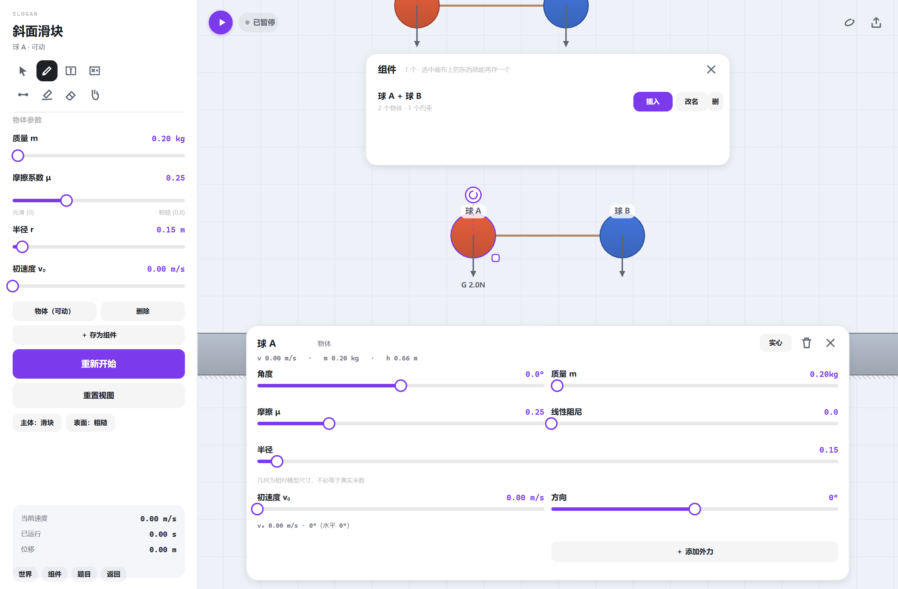

> 组件库**不是质量背书**：模型本身就是错的话，存下来的也是错的。而且它只存在本地，换设备就没了。

细节见 [docs/COMPONENTS.md](docs/COMPONENTS.md)。

## 假设可勾选

生成后的「假设」不是一句说明，是**左侧参数面板里一排可点的 chip**：点一下换一个取值，几何立刻重算。

| 能切什么 | 场景 | 背后改的是 |
|---|---|---|
| 滑块 / 小球 / 小球·滚动 | 斜面滑块、斜面+圆弧 | `params.ball`、`params.model` |
| 光滑 / 粗糙 | 斜面、斜面+圆弧（分开）、板块 | `params.mu`、`params.muArc` |
| 固定 / 可移动 | 半圆槽 | `params.fixed` |
| 不计 / 计入空气阻力 | 平抛 | `params.drag` |

因为只写 `params`，改完的分享串仍然压得回 `p1.`（单元测试里锁了这条）。

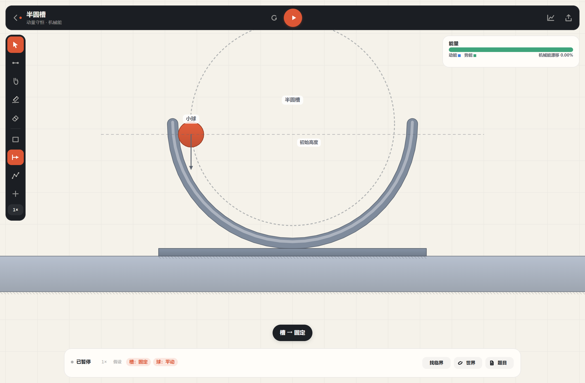

## 18 个预置场景（生成器的落点，不在首页展示）

| 场景 | 拨的是什么 | 你会看到 |
|---|---|---|
| **斜面滑块** | 滑块（矩形质点）或小球（滚动按实心球）；θ、μ、v₀、长度 | a = g(sinθ−μcosθ)；实心球纯滚动 a = 5/7·g·sinθ。滚动的球更快——静摩擦不做功 |
| **斜面 + 圆弧** | 圆弧光滑或粗糙 | 光滑圆弧机械能守恒，粗糙圆弧按 μ 损耗；半径可调 |
| **半圆槽** | 槽放在光滑水平面（可移动） | 小球**照样回到等高**；变的是槽被推走 0.265 m。要固定槽，把角色改成地形 |
| **竖直圆轨道** | 轨道半径 R、v₀；判据：脱离轨道 | 拖 v₀ 从慢到快，轨迹在某个速度上翻转（≈5.19，理论 √(5gR) ≈ 5.17） |
| **平抛** | 不计空气阻力 | 同样的 v₀ 命中目标；打开空气阻力，落点前移、够不到目标 |
| **弹簧振子** | k、m | X 形正弦曲线；T = 2π√(m/k)，与振幅无关 |
| **单摆** | 绳长 L、摆角 θ₀ | 绳的拉力一直在变：最低点最大、最高点最小；机械能守恒（漂移 0.02%） |
| **电场中的带电粒子** | 匀强电场 E | E>0 走抛物线；E=0 就是直线 |
| **板块 + 平抛** | 光滑平台、薄板不翻转；板块 μ、板长、v₀ | 薄板被物块推着走，物块从右端飞出做平抛（2024 新课标 12 题） |
| **点电荷** | 库仑力 k、电荷 q、质量 | 试探电荷在两个固定电荷的场里偏转 |
| **卫星/双星** | G、恒星质量、轨道半径、v₀ | 圆/椭圆轨道；可改速度变椭圆 |
| **两球碰撞** | 质量、v₀、恢复系数 | 弹性/非弹性碰撞；动量与动能判据同屏 |
| **气缸/理想气体** | T、n、P0、活塞质量 | P=nRT/V；升温看活塞上移 |
| **滑轮/连接体** | 两端质量、绳长、滑轮 | 绳长约束；轻的一侧上升、重的一侧下降 |
| **多过程（折线）** | 斜面角度/长度、水平长度/摩擦、上坡 | 斜面 → 粗糙水平 → 上坡 |
| **多过程（圆弧）** | 同上 + 圆弧半径/圆心角 | 斜面 → 粗糙水平 → 圆弧 |
| **多体碰撞** | 球数、质量、v₀、恢复系数 | 三个等质量球：速度逐个传递，总动量/动能守恒 |
| **正交电磁场** | E、B、q、m | 电荷同时受电场和磁场：摆线/偏转轨迹 |

**不做 A/B 对照，也不做「刷题型题库」。** 题库页只是**题目的入口列表**：不判对错、不给答案、不按知识点出练习。
18 个预置场景是通用交互组件的样板，不在首页展示，只做生成器的落点和库卡片预览。
题目生成出来的也是同样的普通组件，所以生成后随时能改。

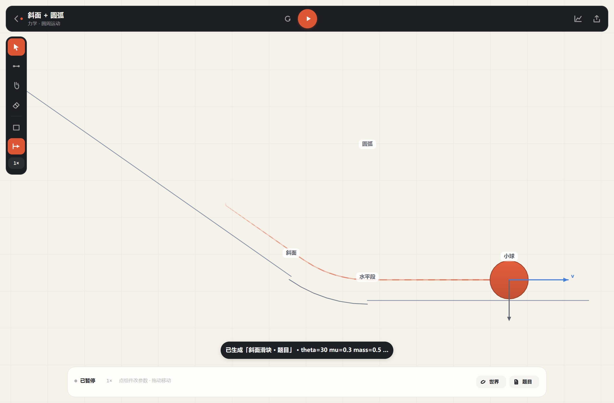

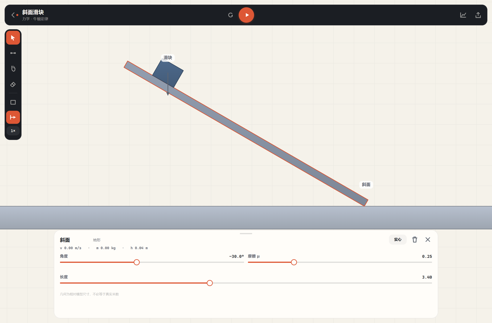

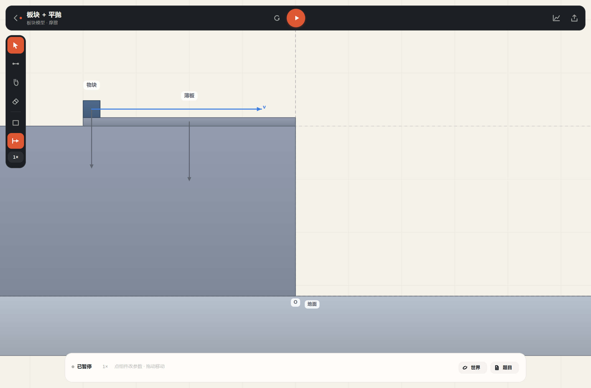

## 代码分层

```
packages/core      Scene 类型 / 形状转换 / 吸附 / 判据 / 参数表 / 序列化 / 题库 / 建模库 / 组件 / 预置场景
packages/physics   Planck 适配 / 自定义场力 / 守恒监视 / 轨道约束
packages/render    正交侧视相机 / 2D 填充与描边 / 受力箭头 / 轨迹与矢量 / 视觉语法
packages/ui        Canvas 自绘 UI / 页面（题库·模型·用户）/ 检查器 / 图表
apps/web           Web 壳（Vite）
apps/miniprogram   小程序壳（原生 canvas 2d，约 160 行适配）
```

**Scene JSON 是唯一真相源**：渲染、物理、判据都从它派生；分享、撤销全靠在 JSON 上换值。
`packages/core` 零渲染依赖，判据在 Node 里 headless 跑。

UI 全部画在 canvas 上（无 DOM），输入被归一化成 `pointerDown/Move/Up + wheel + key`。
Web 和小程序共用同一份 `@ui/app`，只换宿主。安全区由宿主通过 `insets` 传进来。

## 分享

- 预置场景只存「预设 id + 参数/假设/编辑」：`p1.trough.…`，约 100–250 字符，塞得进小程序的分享 path；
- 自由画布回退到完整 JSON（`s1.…`，约 4.6 KB），Web 端足够；
- 打开链接/分享卡片后重建场景，滑杆继续生效（`meta.preset` 会跟着走）。

## 这一版验证了什么

- **物理**：`tests/acceptance.test.ts` 9 项（斜面 a、实心球滚动、半圆槽等高、圆轨道临界值 vs √(5gR)、CCD 不穿透、40 形状稳定），
  数字见 [docs/PHYSICS.md](docs/PHYSICS.md) §2。
- **真题**：9 道原卷计算题的「能建 / 不能建」边界记录在 [docs/PHYSICS.md](docs/PHYSICS.md) §5。
  注意：那份回归原本跑的是规则解析，规则路删掉后它变成**人工记录**——现在的边界靠 `scripts/ai-check.mjs` 打真实接口测。
- **小程序**：`scripts/mp-verify.mjs` 16 项（启动、安全区、步进、圆弧摩擦、拖拽逆投影、分享串、题库详情、**没有 AI 时明确失败**、落库链路、建模库、假设 chip）。
- **画图**：`scripts/shots-draw.mjs` 25 项（识别 5 类、吸附、缩放手柄、场两按钮 + 区域、物理、存组件→插入）。
- **页面**：`scripts/shots-bank.mjs` 19 项（三栏、点题进详情、没配 key 时明确失败、计划落库、打开已建、手动搭、用户页清空、持久化、手机尺寸、改名迁移、AI 设置）。
- **批注**：`scripts/shots-ink.mjs` 9 项。

## 已知边界

- **生成入口**：只有「点题库里的一道题」和「贴题干」两条，都要先配 API key。图片识别 / 拍照没做，也没有假按钮。
- **生成器**：由模型读题决定（需要配 key）。选已有场景 / 拼阶段 / 搭指令 / 明确拒绝四条出路，**没有离线兜底**——建不了就手动搭。
  **建不了就手动搭**：详情页按钮会变成「手动搭 →」，点开是空白画布。题目同时记进「我的题目」。
- **题库内容**：15 道（8 道可建模的示例题 + 7 道真实高考题）。示例题自编，页面和 README 都标了「非真题」；
  要扩充就改 `packages/core/src/bank.ts`，`tests/bank.test.ts` 会逐条验证「说能建的是不是真能建」。
- **约束**：绳/杆/弹簧/铰链/滑轮/轨道/棱柱已接；传送带还没有。
- **没有预置组件库，只有你自己存的**：气缸、滑轮这类「多体 + 约束」的组合不能一键插入。搭法：
  画两个球 → 连接工具连绳 → 「＋ 存为组件」。
- **组件不跨设备**：跟着建模库存在 localStorage / `wx.setStorageSync` 里，导出/导入还没做；也不会自动去重。
- **手绘识别不是万能的**：手抖太厉害会判成折线；画歪的方块会被规整成**轴对齐**矩形；认错了靠撤销重画。
- **磁场**：引擎支持 qv×B（速度旋转），预置场景的比荷仍是教学约定。
- **跨设备确定性**：不同 CPU/引擎的浮点差异会让临界值在第 4 位有效数字上不同，所以只显示 3 位。
- **小程序 AppID**：`project.config.json` 里的 `wxf5f318eb7cfbbe64` 是本地测试用的，发版前换成正式 AppID，
  并按「工具类目 / 免费工具」备案。

## 文档

| 文档 | 什么时候看 |
|---|---|
| [docs/CODEMAP.md](docs/CODEMAP.md) | 想改代码，先看这个（含 Scene 数据模型、文件地图、常见改动从哪下手） |
| [docs/PHYSICS.md](docs/PHYSICS.md) | 怀疑数字不对，或想知道哪些题建不了 |
| [docs/AI.md](docs/AI.md) | 想接 AI 建模 / 改提示词 / 上线转发层 |
| [docs/AGENT.md](docs/AGENT.md) | 想知道 agent 该有什么能力（手 / 眼 / 尺），以及为什么不给它任意代码 |
| [docs/DECISIONS.md](docs/DECISIONS.md) | 想知道「为什么这么做」，以及哪些当初的判断被推翻了 |
| [docs/RESEARCH.md](docs/RESEARCH.md) | 想知道「该做什么」的依据（真题分布 / 开源 / 竞品 / 定位） |
| [docs/DRAWING.md](docs/DRAWING.md) | 改画布、识别、视觉语法、批注 |
| [docs/COMPONENTS.md](docs/COMPONENTS.md) | 改组件抽取与插入 |
| [docs/MINIPROGRAM.md](docs/MINIPROGRAM.md) | 改小程序壳或跑真机验证 |
| [docs/REFACTOR-PLAN.md](docs/REFACTOR-PLAN.md) | 继续拆 `app.ts` |
| [SESSION-HANDOFF.md](SESSION-HANDOFF.md) | 接手的第一个人先读这个 |

> 原始方案是一份仓库外的架构文档（`wechat-mp-plan/physics-modeling-architecture-v1.md`），
> 已经被大量偏离——每一处偏离和原因都记在 [docs/DECISIONS.md](docs/DECISIONS.md)。
