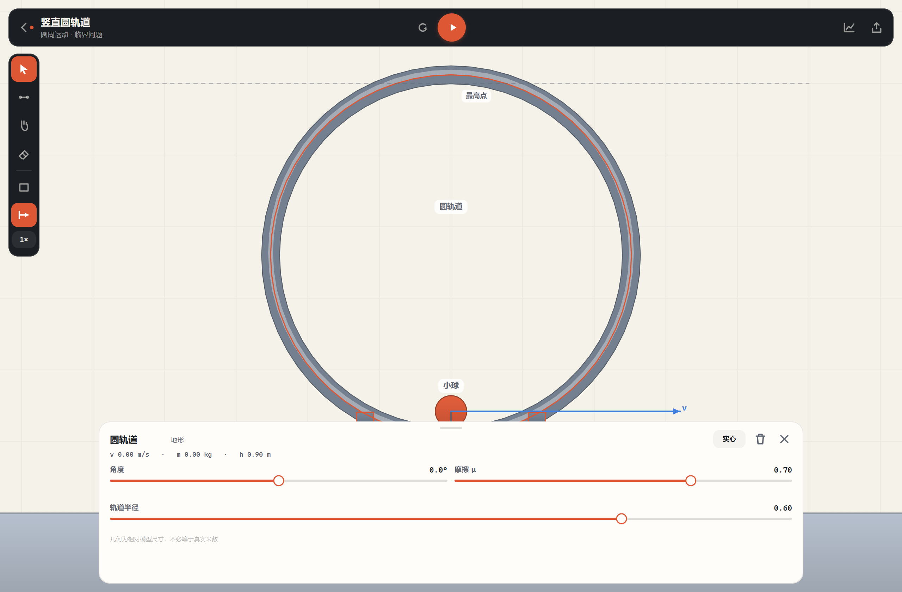
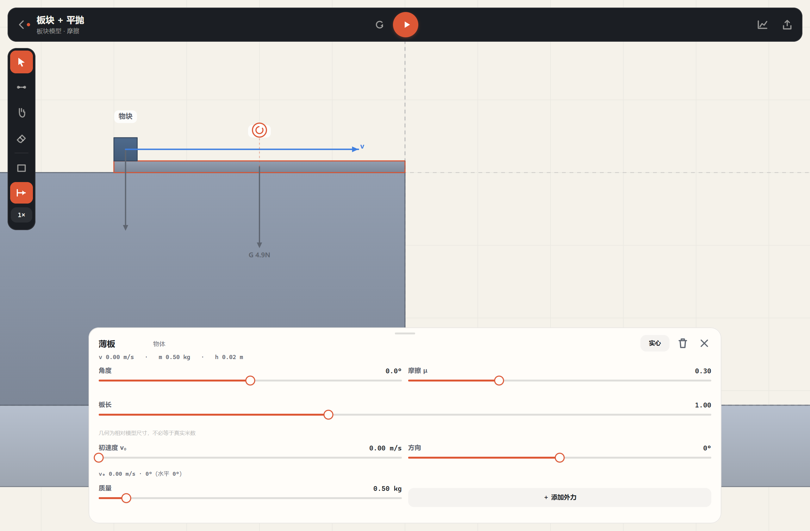
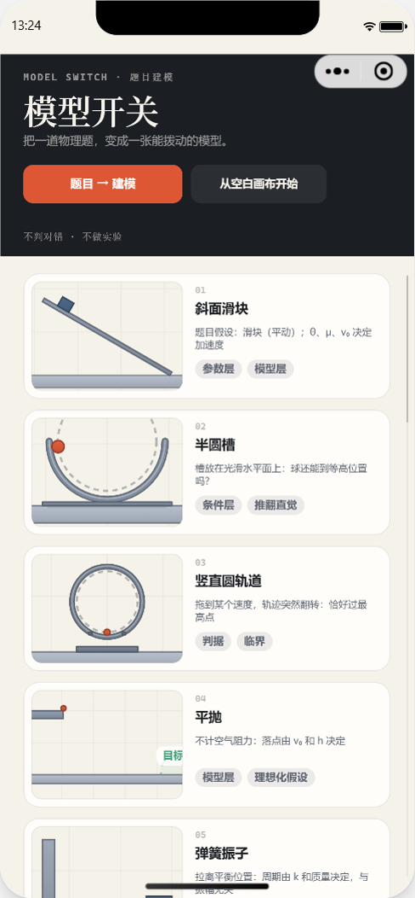
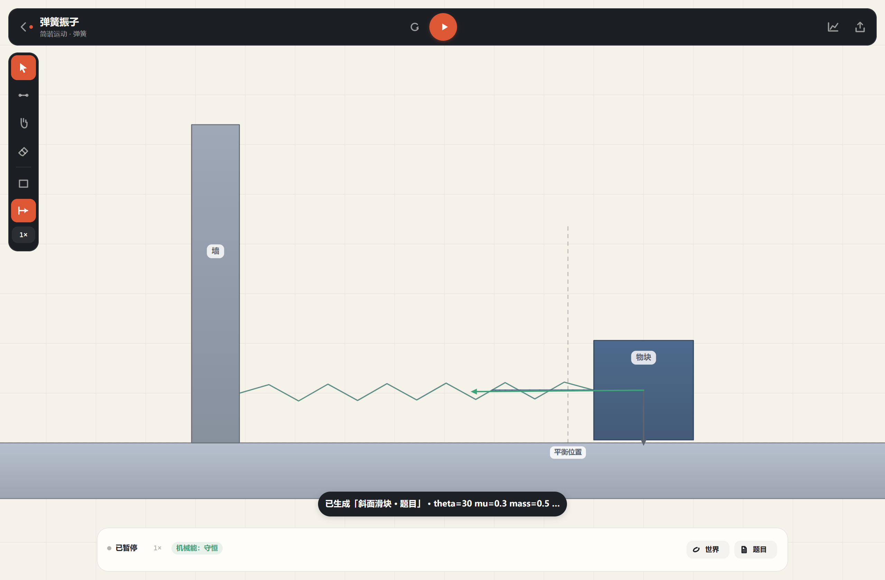
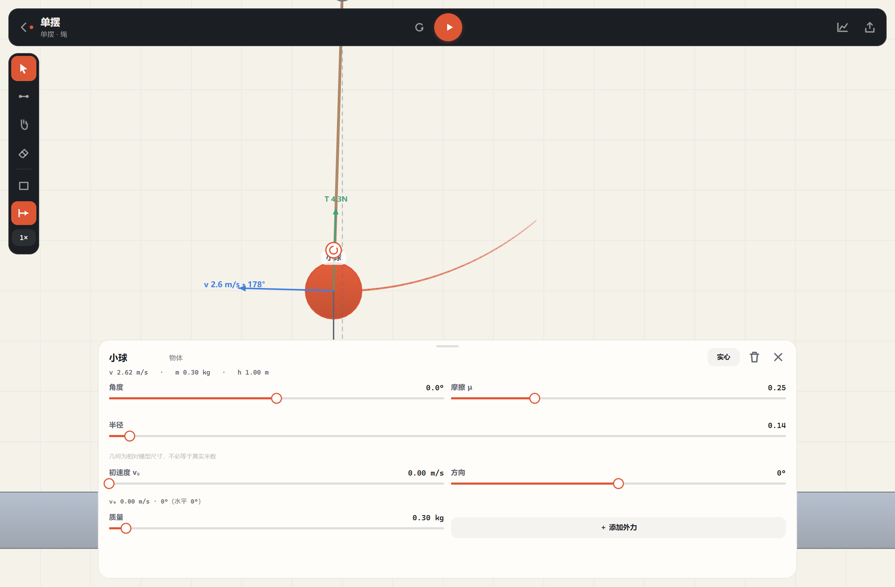
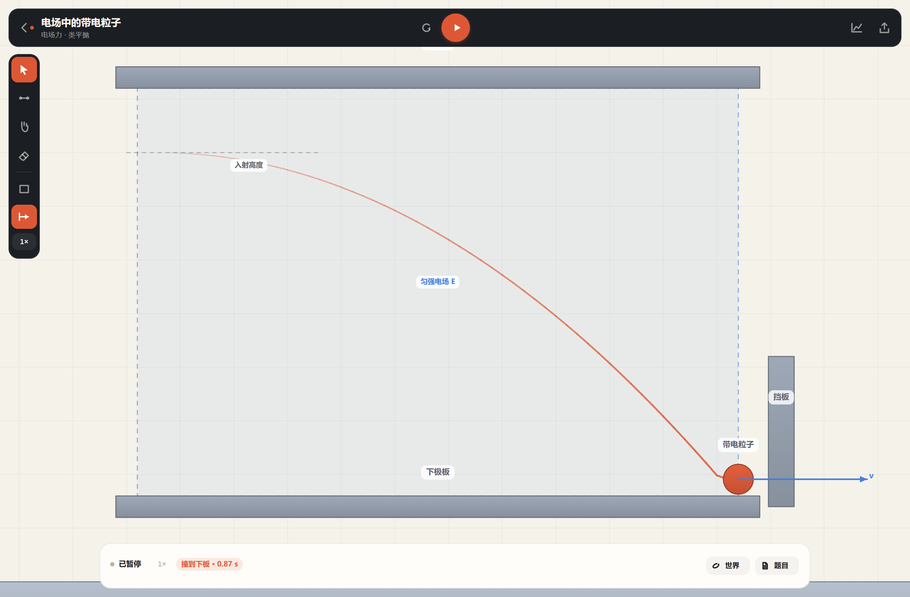

# Slogan

> 把一道高中物理题，变成一张形象、能拨动的物理模型。
>
> 新会话续作请先读 [SESSION-HANDOFF.md](SESSION-HANDOFF.md)。

面向高中物理的**题目 → 建模工具**：一道题进去，一张可运行、可修改的模型出来，存进自己的收藏夹。Web 与微信小程序两个壳都已跑通；核心三层完全平台无关。

## 产品定位

「Slogan」不是课程，也不是实验复现。它只做一件事：**把题目变成一张形象、易懂、可拨动的物理建模**。

- **底部三栏**：用户 / 题库 / 模型；进到画布后是**左参数面板 + 右舞台 + 底部 v–t 图**。题库（首页，按物理知识分类的题目）→ 点一张题先看完整题干 → 再决定「生成建模」→ 模型进「模型」页（收藏夹，自己建文件夹分类）。
- **输出是模型，不是答案**：播放后看到轨迹、速度/受力箭头、v–t、能量与动量判据；改一个条件再跑，看结果怎么变。不判对错、不替代老师讲题、不追求逼真。
- **生成不保证对，所以必须可改**：生成的是初稿。拖拽、检查器、世界面板、手绘、多过程链都能继续改；建不了就**在原地说清楚缺什么**，不悄悄给一个错模型。
- **零后端**：建模库、文件夹、自己导入的题目都存在本地（Web: localStorage / 小程序: `wx.setStorageSync`），不登录、不上传。

Web 与微信小程序两个壳：

```
┌────────────────────┬─────────────────────────────────────────┐
│ SLOGAN             │  ▶  ● 已暂停          题目初稿 · 可改  ⬤ ↗ │
│ 斜面滑块           │                                         │
│ 球 A · 可动        │                                         │
│                    │              2D 平面画布（Canvas 2D）     │
│ ▸ ▱ ⇉ ⌗           │      物体 · 轨迹 · 速度/受力箭头 · 场区域 │
│ ↪ ✎ ⌫ ✋          │                                         │
│                    │                                         │
│ 质量 m      0.20kg │                                         │
│ ──────●────────    │                                         │
│ 摩擦 μ      0.25   │                                         │
│ ──●────────────    │                                         │
│ 假设 光滑/粗糙      │                                         │
│                    │                                         │
│ [   重新开始   ]   ├─────────────────────────────────────────┤
│ [   重置视图   ]   │ m/s                                     │
│ 主体: 滑块         │            ╱‾‾‾‾‾                      │
│                    │        ╱‾‾‾                             │
│ 当前速度   0.00 m/s│   ╱‾‾‾‾                                │
│ 已运行     0.00 s  │                                         │
│ 世界 组件 题目 返回 │                               t (s)   │
└────────────────────┴─────────────────────────────────────────┘
```

窄屏（手机 / 小程序，宽度 < 760）左面板变成底部抽屉，图表收起——舞台占满，其余照旧。

## 快速开始

```bash
npm install
npm run dev          # Web：http://127.0.0.1:5173
npm test             # 117 个单测：投影往返、物理验收、吸附、判据、序列化、题库、建模库、真实高考题覆盖
npm run typecheck
npm run validate     # 三项技术验证（摩擦覆写 / 洛伦兹漂移 / Canvas 性能）
npm run build        # Web 产物：约 452 KB / gzip 124 KB
npm run build:mp     # 小程序包：约 466 KB → apps/miniprogram/miniprogram/utils/app.js
```

需要 Node ≥ 20。实测环境：Node 24 / Chrome 155 / Windows。

### 小程序

1. `npm run build:mp`
2. 微信开发者工具 → 导入项目 → 目录选 `apps/miniprogram` → AppID 用你自己的（`project.config.json` 里现在填的是一个测试 AppID，换成你的即可）→ 不使用云服务。
3. 想跑自动化验证：
   ```bash
   # 开发者工具：设置 → 安全设置 → 打开服务端口
   cli.bat open --project D:\Slogan\apps\miniprogram
   cli.bat auto --project D:\Slogan\apps\miniprogram --auto-port 9420
   node scripts/mp-verify.mjs    # 16 项：启动、安全区、步进、题目假设、拖拽、分享、题库详情生成、建模库、假设 chip、临界
   ```

小程序壳只有 130 行左右（[pages/index/index.js](apps/miniprogram/miniprogram/pages/index/index.js)）：取 canvas、喂尺寸与安全区、转发触摸、驱动帧循环、题目输入弹窗。其余全部来自打包后的 `core + physics + render + ui`。

## 题库（首页）

首页不是示例卡片，是**一道一道题**，按物理知识模块分类：

- **分类**：力学 / 电磁学 / 热学（有导入题时多一个「我的题目」）。口径沿用 304 卷真题统计的「知识模块」轴。
- **每条题带状态**：`可建模` / `已建` / `暂不支持`——状态来自 `parseProblem` 的真实结果，`tests/bank.test.ts` 逐条锁死，不存在「点了才知道建不了」。
- **来源分三类**：真题（标卷号，可核）／示例题（自编，明确标「示例题（自编，非真题）」）／我的题目（自己导入的）。
- **点一下先看题**：进入题目详情页，完整题干（可滚动）、来源、标签、状态都在；底部才是「生成建模 →」。建过的题这里变成「打开模型 →」，同一道题不会重复建。


## 生成建模

两条路，同一条生成链路：题库里点一张题 → 详情页按「生成建模」；或者右上角「生成建模」直接贴题干。

- 现在能做：识别斜面 / 斜面+圆弧 / 半圆槽 / 平抛 / 单摆 / 弹簧 / 圆轨道 / 板块+平抛，抽出 θ、μ、v₀、R、m、k、L、h。
- 建不了**不关弹层**，在原地说明缺什么（缺哪类建模、当前支持哪些）；题目同时记进题库「我的题目」，改好题干可以直接再生成。
- 生成成功：模型立刻存进建模库，画布打开就是那一份；舞台左上状态药丸旁边标「题目初稿 · 可改」。


## 建模库（收藏夹）

生成的模型都在这一页，像音乐收藏夹：

- **文件夹**：自己起名（「临界题」「力学第一章」），模型点 `⋯` 移进去。删文件夹时里面的模型回到「未分类」，不会跟着消失。
- **本地持久化**：刷新、重开小程序都还在；零后端、不登录。
- **容量**：上限 60 个模型、20 个文件夹，超了明确提示，不静默丢；页面右上角显示占用。
- **改了就写回**：在画布上拖过、改过参数，返回建模库时写回同一条记录（不新增副本）。


## 用户页

第三栏是「用户」——没有账号体系，只有这台设备上的数据：

- 一眼看到 **建模数 / 文件夹数 / 我的题目数 / 占用空间**；
- 数据管理：清空建模库、清空我的题目（都先弹确认，说明会删几个、什么会保留）；
- 关于：不判对错、不做实验、完全免费。


## 编辑器：左参数、右舞台、底部图表

画布页不是一堆工具栏堆出来的，而是一个「参数 → 舞台 → 曲线」的结构（见上面的布局图）：

- **左**：模型标题 + 8 个工具（选择 / 手绘 / 电场 / 磁场 / 连接 / 批注 / 橡皮 / 平移）→ 参数滑杆（没选中时是场景参数 θ/μ/v₀/R，选中后换成物体参数：质量、摩擦、半径/长度、初速度）→ 假设 chips → 重新开始 / 重置视图 → 读数卡 → 世界 / 组件 / 题目 / 返回。滑杆右侧是紫色数值，下面标两端含义（「光滑 (0) / 粗糙 (0.8)」）。
- **右**：播放键 + 状态药丸（从题库生成的模型还会多一个「题目初稿 · 可改」），右上角分享与世界面板；舞台本身可画、可拖、可缩。场景按舞台取景，不会被面板压住。
- **下**：v–t / h–t / y–x 图跟着仿真长出来，直接占满舞台底部（不是角落小卡片）；没有图表观测器时舞台自动铺满。选中物体时检查器浮在舞台底部。
- **读数卡**：当前速度 / 已运行 / 位移 + 判据 chip，钉在面板底部。
- **窄屏**（< 760）：左面板变底部抽屉（内容超出就上下拖）、图表收起，舞台占满。
- **配色**：白面板 + 冷灰舞台 + 紫色强调（滑杆、按钮、曲线、选中）。


## 在画布上画：画什么，什么就是组件

**没有预置组件库**。左栏只有笔、电场、磁场——不选「矩形/圆/三角」，也不点「点电荷/天体/气缸」。你画成什么样，系统把它变成什么样：

| 画出来的 | 规整成 | 默认物理性质 |
|---|---|---|
| 一个圈 | 圆（半径取均值） | 球：会动、会滚、会落 |
| 一个方块 | 轴对齐矩形 | 地形：固定、能挡能托，μ 可调 |
| 一个三角 / 多边形 | 多边形 | 地形 |
| 一条线 | 直线（细线地形） | 轨道 / 地面 / 挡板 |
| 一条曲线 | 折线 | 同上 |
| 太小的点 | 不产生东西 | — |

- **场有两个独立按钮**：点「电场」或「磁场」，**按住拖出一个矩形**——场就长在这块区域里（点一下 = 全场）。建完自动选中，左侧面板调场强和方向（电场是角度滑杆，磁场是 向外 · / 向里 ×）。
- **「光滑」不是一个组件，是一个数**：把摩擦 μ 拖到 0 就是光滑，μ > 0 就是粗糙（表面挂短斜纹）。双击在 地形/物体/轨道 之间循环——方块想当滑块，双击两次。
- **大小能直接拖**：选中任何东西，包围盒右下角的小方块就是缩放手柄；检查器里还有精确滑杆。
- **场只作用于带电体**：画完场要给球设一个电荷 q，否则什么都不动（toast 会提醒这句）。


细节与识别阈值见 [docs/DRAWING.md](docs/DRAWING.md)。

## 组件：从使用中沉淀

组件库不是我们写的，是**用出来的**。编辑器永远追不上「两个球 + 一根绳 + 一个斜面 + 一个电荷」这种临时组合，但用户自己知道哪一坨好用——做出来一次、觉得顺手，就存下来。

- **存**：选中一个物体 → 左侧「＋ 存为组件」。画布是单选，所以不是框选，而是**从点中的物体顺着约束把整段找出来**：点中球 A，绳子连着球 B，存下来的就是「球 A + 球 B + 绳」；点中一个孤立的滑块，就只存滑块。
- **存什么**：物体（形状/质量/电荷/摩擦/初速度）、它们之间的约束（绳/杆/弹簧/滑轮/轨道/导轨）、气体系统、以及组件需要的世界开关（库仑力、N 体引力）。**不存**观测器、判据、场与区域——那些是场景级的，跟着组件走只会制造困惑。
- **插**：左侧「组件」→「插入」，落到舞台中央，所有 id 换成新前缀（约束两端跟着换），插完自动选中，可以马上拖、马上改参数。
- **和预置场景的区别**：预置场景有 `layout()`，改 θ 会重排几何；组件没有，插到哪就是哪。前者是「一道题的典型情形」，后者是「我常用的一坨东西」——**别让组件也带 layout，那会把它变回预置**。


上限 16 个物体（防止把整个场景吸进来）、40 个组件。边界与后续（导出 `.json`、拖到画布、组件带参数）见 [docs/COMPONENTS.md](docs/COMPONENTS.md)。

> 组件库**不是质量背书**：LLM 生成的模型如果本身就是错的，存下来的也是错的。而且它只存在本地，换设备就没了。

## 假设可勾选

生成后的「假设」不是一句说明，是**左侧参数面板里一排可点的 chip**：点一下换一个取值，几何立刻重算。

| 能切什么 | 场景 | 背后改的是 |
|---|---|---|
| 滑块 / 小球 / 小球·滚动 | 斜面滑块、斜面+圆弧 | `params.ball`、`params.model` |
| 光滑 / 粗糙 | 斜面、斜面+圆弧（斜面/圆弧分开）、板块 | `params.mu`、`params.muArc` |
| 固定 / 可移动 | 半圆槽 | `params.fixed`（`kind` 在 static/rigid 之间切） |
| 不计 / 计入空气阻力 | 平抛 | `params.drag` |

因为只写 `params`，改完的分享串仍然压得回 `p1.`（单元测试里锁了这条）。窄屏（手机 / 小程序）面板变底部抽屉，chip 跟着进去，照样能点。


## 18 个预置场景（生成器的落点，不在首页展示）

| 场景 | 拨的是什么 | 你会看到 |
|---|---|---|
| **斜面滑块** | 题目假设：滑块（矩形质点）或小球（滚动按实心球）；θ、μ、v₀、长度 | 滑动的 a = g(sinθ−μcosθ)；实心球纯滚动 a = 5/7·g·sinθ。滚动的球更快——静摩擦不做功，滑动的动摩擦直接耗散。滑块/小球由题干决定，不再用 A/B 切换 |
| **斜面 + 圆弧** | 题目假设：圆弧光滑或粗糙 | 滑块/小球从斜面进入圆弧：光滑圆弧机械能守恒，粗糙圆弧按 μ 损耗；半径可调 |
| **半圆槽** | 题目假设：槽放在光滑水平面（可移动） | 小球**照样回到等高位置**；真正变的是槽被推走了 0.265 m，系统质心纹丝不动。要固定槽，选中槽把角色改成地形即可 |
| **竖直圆轨道** | 轨道半径 R、v₀；判据：脱离轨道 | 拖 v₀ 从慢到快，轨迹在某个速度上翻转（≈5.19，理论 √(5gR) ≈ 5.17） |
| **平抛** | 题目假设：不计空气阻力 | 同样的 v₀ 命中目标；在「世界」里打开空气阻力，落点会前移、够不到目标 |
| **弹簧振子** | 参数 k、m | 拉离平衡位置松手：X 形正弦曲线；T = 2π√(m/k)，与振幅无关。力箭头里能看到弹簧力反向 | 
| **单摆** | 绳长 L、摆角 θ₀ | 绳的拉力一直在变：最低点最大、最高点最小；机械能守恒（漂移 0.02%） |
| **电场中的带电粒子** | 题目假设：匀强电场 E | E>0 走抛物线；把 E 调到 0 就是直线 |
| **板块 + 平抛** | 题目假设：光滑平台、薄板不翻转；板块 μ、板长、初速度 | 薄板被物块推着走；物块从右端飞出做平抛；2024 新课标第 12 题这一类。木板/物块/平台各自可调，底部有 O 点参考线 |
| **点电荷** | 库仑力 k、电荷 q、质量 | 试探电荷在两个固定电荷的场里偏转；轨迹/速度/能量都可观测；可把 k 和 q 当模型相对值 |
| **卫星/双星** | G、恒星质量、轨道半径、初速度 | 万有引力下的圆/椭圆轨道；轨迹和能量守恒；可改速度变椭圆 |
| **两球碰撞** | 质量、初速度、恢复系数 | 光滑水平面上的弹性/非弹性碰撞；动量与动能判据同屏 |
| **气缸/理想气体** | 温度 T、n、外界压强 P0、活塞质量 | P=nRT/V；升温看活塞上移；P/V/T 读数在气体上、世界面板里有 T 滑杆 |
| **滑轮/连接体** | 两端质量、绳长、滑轮 | 绳长约束；轻的一侧上升、重的一侧下降；加速度和能量 |
| **多过程** | 斜面角度/长度、水平长度/摩擦、上坡/圆弧 | 斜面 → 粗糙水平 → 上坡；斜面 → 粗糙水平 → 圆弧；可编辑链 |
| **多体碰撞** | 球数、质量、初速度、恢复系数 | 三个等质量球：速度逐个传递，总动量/动能守恒 |
| **正交电磁场** | E、B、q、m | 电荷同时受电场和磁场：摆线/偏转轨迹 |

**不做 A/B 对照，也不做「刷题型题库」。** 题库页只是**题目的入口列表**：不判对错、不给答案、不按知识点出练习。18 个预置场景是通用交互组件的样板（点电荷/库仑、N 体引力、碰撞、板块、斜面、圆轨道…），不在首页展示，只做生成器的落点和库卡片预览。题目生成出来的也是同样的普通组件，所以生成后随时能改。题干里出现「滑块/小球、滚动/纯滚动、光滑/粗糙、固定/可移动、空气阻力」时，生成器会把假设写进场景，状态条上就是一排可点的假设 chip。







小程序真机（模拟器 390×844 @3x）：



## 力学与场力（v3）：纯 2D，完整受力

- **视图**：纯 2D 侧视，没有 3D/斜视。相机只平移缩放，测量、对答案不会被透视干扰。
- **视觉**：物体用「上浅下深的平面填充 + 深色描边 + 细高光」，轨迹、场地、卡片统一到一套纸感配色里。
- **外力**：选中物体后在属性面板直接给 Fx / Fy（−20…20 N），场上出现橙色 F 箭头。
- **场力**：匀强电场 qE、匀强磁场（速度旋转，严格保模长）、点源场、阻力。蓝色 qE 箭头。
- **受力图**：G（灰）、F（橙）、qE（蓝）、T（绿）；选中物体时箭头旁标数值（N）。箭头长度相对重力归一，拉力和重力能直接比。
- **约束**：绳（连接工具）、杆 / 弹簧 / 铰链（引擎与预设）。弹簧用真实力 F = k(l−l₀)，机械能里补了 ½k(l−l₀)²，守恒判据能过（实测 0.7%）。
- **连接工具**：点一个物体、再点另一个，生成一根绳（长度 = 两点距离），拉紧后传递拉力。
- **新场景**：弹簧振子（改 k / m 看周期）、单摆（绳的拉力随位置变）、电场中的带电粒子（把 E 调到 0 就变成直线）。
- **每组件检查器**：点组件 → 底部检查器直接改 **角度、摩擦 μ、几何（斜面/折线/多边形长度、圆弧/圆半径、圆轨道半径）、初速度矢量（大小 + 相对水平的角）、质量、外力**；几何按相对模型尺寸调，不必等于真实米数。
- **多外力**：被观测物可以点「＋ 添加外力」加任意多个力；每个力有 F1/F2… 彩色标签和独立箭头，点标签后用「大小 / 方向」两根滑杆调，多力可区分、可叠加。
- **精简**：材质选择去掉了（摩擦按组件单独设）；「物理模型 / 角色」面板已去掉——画布上**双击**循环 地形/物体/轨道，检查器只留几何/运动/外力。圆弧地形用「让小球贴着轨道走」开关保留轨道约束。
- **地形贴地**：画/拖斜面、轨道这类地形时，用离地面最近的点做参照，离地近就吸到地面，低于地面就抬起来，不会穿模。
- **同类逻辑**：两块地形用连接工具点两下会**合并成一条连续地形**（复合体），物体之间仍然是绳连接。
- **编辑覆盖层**：检查器改过的字段记在 `scene.edits`，分享串和布局重建后重新盖回去，不再被预置布局冲掉。
- **界面 v4（2026-10）**：深色顶栏/工具轨 + 纸感画布 + 单一烧橙；选择页 4×4 + 2 十八个示例；「从空白画布开始」仍是主入口；检查器最大 1000px 居中，拖拽柄/等宽数值/样式入口收进头部，图表默认收起。设计说明与评审见 [docs/DESIGN.md](docs/DESIGN.md)。
- **速度矢量箭头**：选中的会动物体即使没有观测者，也只画**一根实线 v 箭头**（数值 + 相对水平的角度），拖箭头端点就能改；原来的蓝色虚线手柄和端点圆圈已删除，选中轮廓也从虚线改成实线。
- **斜面 + 圆弧**：做成**组合**而不是单个组件——斜面、圆弧、水平段是独立地形，各自有摩擦；圆弧和斜面在连接点相切，小球能平滑过渡。圆弧半径可调，样式可切细线。新增预置场景「斜面 + 圆弧」，圆弧摩擦按题目假设设置。
- **题目 → 建模**：点题库卡片或右上角「生成建模」贴题干（Web 弹层；小程序是原生输入 modal）。规则解析 8 类模型（含半圆槽、板块+平抛），抽出 θ、μ、v₀、R、m、k、L、h，并识别 滑块/小球、滚动、光滑/粗糙、固定/可移动、空气阻力；失败时在弹层里原地说明缺什么，题目记进「我的题目」。
- **界面 v5.5（2026-10-24）**：首页从「示例卡片墙」改成**题库**（按物理知识分类），生成结果进**建模库**（收藏夹：文件夹、移动、本地持久化）；删掉条件表单、空白画布与 18 个示例卡片。
- **界面 v5.6（2026-10-25）**：底部改成三栏 **用户 / 题库 / 模型**；题库点题先进**题目详情页**（完整题干 + 来源 + 状态），再决定「生成建模」；新增**用户页**（本地数据统计 + 清空 + 关于）。
- **场景控制面板已删除**：参数在左侧面板，世界面板里有重力 g、场强 E、空气阻力开关。
- **修复的两个 bug**：μ 滑杆之前改的是 contactPairs 又被布局覆盖，拖不动；拖斜面会被吸附到地面、角度归零——现在只有"被观测物"才吸附，静态地形不吸附。
- **删除 / 分类 / 手调**：双击切换 地形/物体/轨道，旋转手柄（仅物体），橡皮擦/垃圾桶。







## 三层开关在代码里是什么

| 层 | 产品表现 | 实现 |
|---|---|---|
| 模型层 | 质点⇄刚体、光滑⇄粗糙、有无阻力 | `Body.kind`（particle/rigid）+ `contactPairs` 的 μ + `Field.enabled` |
| 条件层 | 固定⇄可移动、有界⇄无界 | `Body.kind` static/dynamic、`Region` 限定场的作用域、`track` 约束 |
| 参数层 | 选中组件后的检查器（角度/摩擦/速度/质量/多个外力） | 直接改 `Body` 字段（`transform.angle`、`friction`、`velocity`、`mass`、`forces`），同时写进 `scene.edits`；布局/分享后重新应用；场景参数走 `params` |

**Scene JSON 是唯一真相源**：渲染、物理、判据都从它派生。分享、撤销全靠在 JSON 上换值。`packages/core` 零渲染依赖，判据搜索在 Node 里 headless 跑。

```
packages/core      Scene 类型 / 形状转换 / 吸附 / 判据 / 参数表 / 序列化 / 题库 / 建模库 / 预置场景
packages/physics   Planck 适配 / 自定义场力 / 守恒监视 / 轨道约束
packages/render    正交侧视相机 / 2D 填充与描边 / 受力箭头 / 轨迹与矢量
packages/ui        Canvas 自绘 UI / 页面（题库·模型·用户）/ 检查器 / 图表
apps/web           Web 壳（Vite）
apps/miniprogram   小程序壳（原生 canvas 2d，100 行适配）
```

UI 全部画在 canvas 上（无 DOM），输入被归一化成 `pointerDown/Move/Up + wheel + key`。Web 和小程序共用同一份 `@ui/app`，只换宿主。安全区（状态栏、右上角胶囊）由宿主通过 `insets` 传进来。

## 分享

- 预置场景只存「预设 id + 参数/假设/编辑」：`p1.trough.…`，约 100–250 字符，塞得进小程序的分享 path；旧版只带控制值的串会回到预设默认（控制值已删除）；
- 自由画布回退到完整 JSON（`s1.…`，约 4.6 KB），Web 端足够；
- 打开链接/分享卡片后重建场景，滑杆继续生效（`meta.preset` 会跟着走）。

## 批注（讲课用）

老师讲课时要在模型上「指」——圈一个区域、划一条线、标一个位置。左栏里笔尖带波浪线的那个工具是批注。

- **一支笔 + 橡皮擦 + 清空**，没有颜色/粗细/图层。判据是「指出情境里的某处」，不是「把课讲一遍」（见 `docs/ANNOTATION-DESIGN.md`）。
- **点存世界坐标、线宽存屏幕像素**：缩放平移后墨迹跟着模型走，但线条不会变粗。
- **画在最上层**：不会被物体盖住；橡皮先擦墨迹，再擦物体。
- **不进 Scene**：墨迹是 App 的临时状态，不影响物理、判据和分享串；换场景或回选择页自动清空。
- 单点也是一笔（点一下标个位置）；采样间距 0.006 m，手机上一次滑动不会塞几百个点。
- 小程序端同样可用——壳只转发 `pointerDown/Move/Up`，批注走的是同一条指针链路。

> 注意：左栏的「手绘」笔是**建物体**（识别成圆/方块/线，会参与物理），和批注不是一回事。

## 这一版验证了什么

`docs/VALIDATION.md` 里是三项前置验证的原始数据：接触对摩擦可覆写、40 个形状 60–119 fps（桌面，取决于后台负载）、洛伦兹力必须用速度旋转积分（力法 10 圈漂移 12.5%）。

`tests/acceptance.test.ts` 把验收标准写成了测试：

- 斜面滑动 a 误差 < 3%；实心球滚动 a = 5/7·g·sinθ 误差 < 3%
- 光滑斜面 0.5 s 机械能漂移 < 0.5%
- 半圆槽固定/可移动都回到初始高度（< 1%）；可移动时水平动量 |p| < 0.01
- 圆轨道仿真临界值 vs √(5gR) 误差 < 1%（实测 0.24%）
- 25 m/s 小球不穿透 4 cm 薄墙（CCD）
- 平抛无阻力命中、有阻力不命中
- 40 个形状连续步进无 NaN、不超速

小程序端（`scripts/mp-verify.mjs`，15 项）：

- 页面启动、canvas、状态栏/胶囊安全区（top=51, right=100）
- 预置场景步进 1.4 s、轨迹 40+ 点、机械能漂移 0.37%
- 可移动槽（题目假设）水平动量守恒
- 触摸拖拽走逆投影（26 px → 0.236 m，与相机 110 px/m 一致）
- 分享串约 100–250 字符进 `onShareAppMessage` path
- 无运行时异常

画图（`scripts/shots-draw.mjs`，25 项全过）：

- 手绘圆 → 规整成圆且默认是「球」（会动）；方块 → 轴对齐矩形且默认是地形；三角 → 多边形；线/曲线 → 直线/折线
- 画在斜面上的球自动吸附；选中后拖手柄改大小（0.12 → 0.29）；双击切分类；橡皮擦删得掉
- 点「电场」/「磁场」拖区域 → 场只作用在框里（`field.regionId === region.id`）；点一下 = 全场；选中后可改场强与方向
- 画出来的球受重力会掉（真的有物理）；画两个球能用连接工具连成绳
- 工具栏只剩 8 个工具，组件/形状按钮都不在了；预置场景的物理没被改坏（弹簧机械能守恒）
- 选中球 A「存为组件」→ 自动抓到球 B 和绳（`球 A + 球 B`，2 物体 1 约束）→ 面板自动打开 → 插入后 2 个新物体 1 条新约束，id 全是新的，绳挂在新球上

题库 / 题目详情 / 建模库 / 用户页（`scripts/shots-bank.mjs`，15 项全过）：

- 首屏是题库 + 底部三栏（用户 / 题库 / 模型）；15 道题按 力学 11 / 电磁学 3 / 热学 1 分类
- 点题**先进详情**，模型数还是 0；详情页按「生成建模」才进画布并入库
- 建过的题详情页变「打开模型」，点了不新增
- 「暂不支持」的题详情页只说明，没有生成按钮
- 用户页：清空前弹确认，确认后建模清零
- 新建文件夹 → 移入 → 刷新后还在；手机尺寸下卡片、详情、切换都可点

## 已知边界

- **生成入口**：只有「点题库里的一道题」和「贴题干」两条，都走 `parseProblem`。图片识别 / 拍照没做，也没有假按钮。
- **生成器**：当前是离线的规则解析（不是大模型），覆盖 8 类单/双体模型；电磁、热学、光学、波、连接体、多过程等明确拒绝。**没有空白画布**——被拒绝的题先记进「我的题目」，等生成器覆盖了再建。AI 接入时保持同一契约（Scene + 假设 + `unsupported`）。
- **题库内容**：15 道（8 道可建模的示例题 + 7 道真实高考题）。示例题是自编的，页面和 README 都标了「非真题」；要扩充就改 `packages/core/src/bank.ts`，`tests/bank.test.ts` 会逐条验证「说能建的是不是真能建」。
- **约束**：绳/杆/弹簧/铰链/滑轮/轨道/棱柱已接；传送带还没有。
- **没有预置组件库，只有你自己存的**：气缸（活塞+气体）、滑轮（Atwood 组合）这类「多体 + 约束」的组合不能一键插入。搭法：画两个球 → 连接工具连绳，然后「＋ 存为组件」，下次直接插。气缸目前只能从示例场景改（世界面板能调气体 T），改好可以存成组件。
- **组件不跨设备**：跟着建模库存在 localStorage / `wx.setStorageSync` 里，导出/导入还没做。也不会自动去重——同一个组合存两次就是两个组件。
- **手绘识别不是万能的**：手抖太厉害会判成折线；画歪的方块会被规整成**轴对齐**矩形（不支持旋转矩形识别）；认错了靠撤销重画，不做二次确认弹窗。
- **磁场**：引擎支持 qv×B（速度旋转），示例「正交电磁场」已上架；预置场景的比荷仍是教学约定。
- **精度档只影响弧/贝塞尔的采样**：圆用 Planck 的精确 Circle，不靠多边形近似。
- **跨设备确定性**：同一台机器上判据搜索是确定的；不同 CPU/引擎的浮点差异会让临界值在第 4 位有效数字上不同，所以临界值只显示 3 位。
- **小程序 AppID**：`project.config.json` 里的 `wxf5f318eb7cfbbe64` 是本地测试用的，发版前换成正式 AppID，并按「工具类目 / 免费工具」备案。

## 文档

- [docs/DESIGN.md](docs/DESIGN.md) — 界面方向、入口层级与评审
- [docs/DECISIONS.md](docs/DECISIONS.md) — 关键取舍、与架构文档的偏离、被仿真推翻的结论
- [docs/GAOKAO.md](docs/GAOKAO.md) — 真实高考题实测与「能建 / 不能建」边界
- [docs/VALIDATION.md](docs/VALIDATION.md) — 三项前置验证 + 曲面轨道验证的原始数据
- [docs/MINIPROGRAM.md](docs/MINIPROGRAM.md) — 小程序适配与验证实录
- [docs/DRAWING.md](docs/DRAWING.md) — 画图：一笔一个形状、识别阈值、电场/磁场拖区域、物理映射
- [docs/COMPONENTS.md](docs/COMPONENTS.md) — 组件：从使用中沉淀（存什么 / 怎么插 / 边界）
- [docs/CODEMAP.md](docs/CODEMAP.md) — 代码地图

原始方案：[../wechat-mp-plan/physics-modeling-architecture-v1.md](../wechat-mp-plan/physics-modeling-architecture-v1.md)
